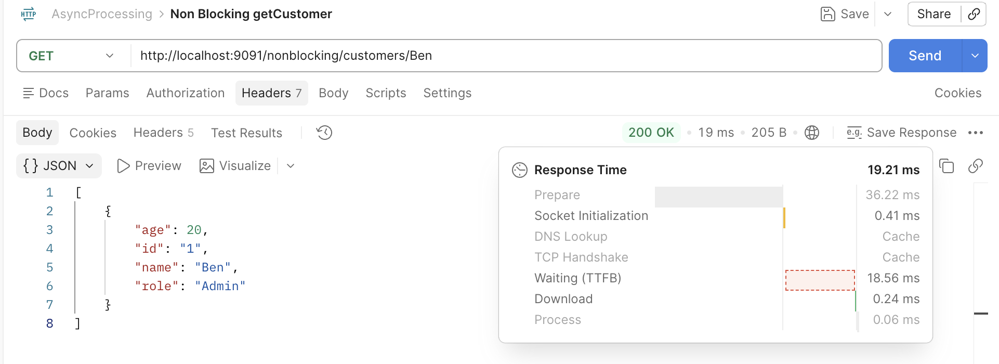
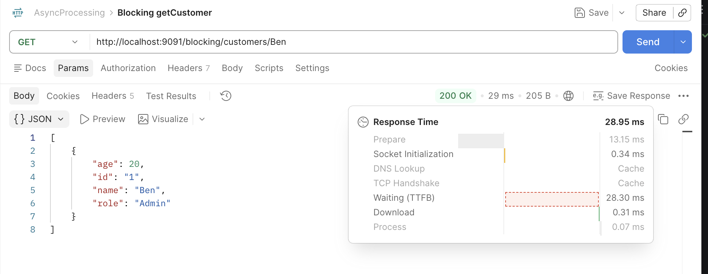
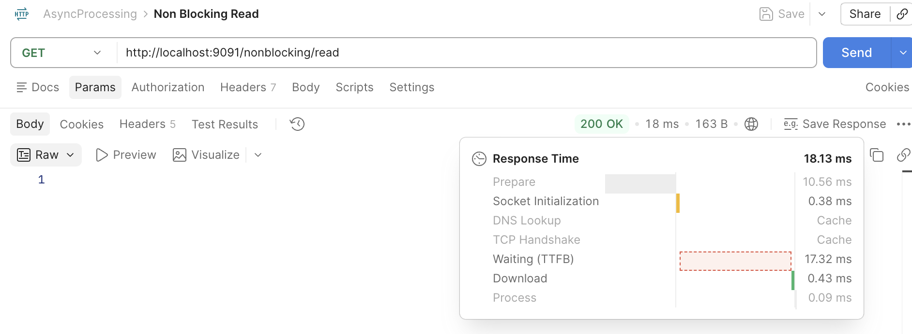
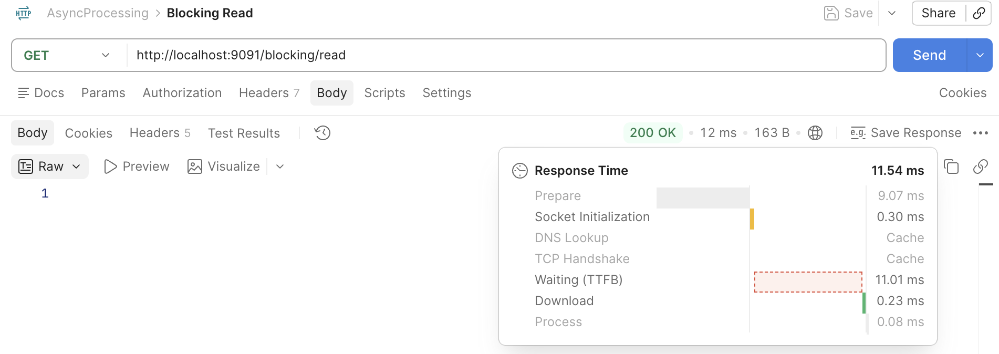

# Spring Boot Async vs Blocking

A small Spring Boot microservice that compares **blocking** and **asynchronous** request handling. Async endpoints use `@Async` and `CompletableFuture` to offload file and customer operations from the request thread to a worker pool.


## Why this project

By default, a servlet thread stays occupied until the work finishes. This project puts the two approaches side by side:

| | Blocking | Async |
|---|---|---|
| Request thread | Held until the work completes | Released once work is handed off |
| Work runs on | Request thread | Separate thread pool |
| Implementation | Plain service call | `@Async` + `CompletableFuture` |

> Note: this is async offloading to a thread pool, not non-blocking I/O (as in WebFlux/Netty). Worker threads still block while doing the work.

## Tech stack

- Java 17
- Spring Boot 4.x
- Spring Web (REST)
- `@Async` with `CompletableFuture`
- Maven

## Getting started

**Prerequisites:** JDK 17+, Maven 3.8+

```bash
git clone https://github.com/<kajal-52>/<async-vs-blocking-springboot
>.git
cd async-vs-blocking-springboot
mvn spring-boot:run
```

The app starts on `http://localhost:9091`.

## API endpoints

| Method | Endpoint | Description |
|---|---|---|
| `GET` | `</nonblocking/read>` | `Read file data utlilizing asynchronous call` |
| `GET` | `</blocking/read>` | `Read file data utlilizing synchronous call` |
| `GET` | `</nonblocking/customers/{name}>` | `get customer data utlilizing asynchronous call` |
| `GET` | `</blocking/customers/{name}>` | `get customer data utlilizing synchronous call` |
| `POST` | `</blocking/customers/save>` | `Add customer utlilizing synchronous call` |
| `POST` | `</nonblocking/customers/save>` | `Add customer utlilizing asynchronous call` |

## Sample response

Postman response from an async endpoint:

 <br>
  <br>
 <br>
 

## Project structure

```
src/main/java/...
├── controller/   # REST endpoints
├── service/      # blocking and @Async service methods
└── config/       # async executor configuration 
```

## Key takeaways

- `@Async` methods return `CompletableFuture<T>`, so the controller can return immediately while work continues on another thread.
- `@EnableAsync` must be present on a configuration class for `@Async` to take effect.
- A custom `ThreadPoolTaskExecutor` gives control over pool size and queue capacity.
